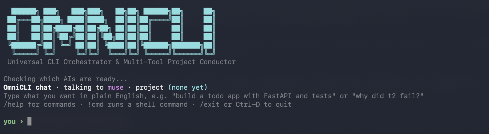

# OmniCLI

OmniCLI brings AI coding CLIs together to plan, build, verify, and review a project as a team. Its chat mode gives you a conversational way to work with that team, while `omnicli team` starts a run directly from the terminal.



OmniCLI is tested on macOS with Python 3.9. Linux should work, but is not yet verified. Windows is not supported because process management uses Unix process groups.

Tested AI CLI versions: Claude 2.1.325, Codex CLI 0.169.0, agy 1.5.9, and Muse 1.4.20.

<!-- Add a screenshot or GIF here. -->

---

## ⚡ Quick Start

Install OmniCLI from a checkout with `python3 -m pip install .`, then start chat mode or a team run:

```bash
# Chat with your lead AI
omnicli
#   you › build a todo app with FastAPI, SQLite and tests
#   you › why did t2 fail?
#   you › /status        (/help lists all commands; !ls runs a shell command; Ctrl-D quits)

# Start a team run directly
omnicli team "build a todo web app with a FastAPI backend, SQLite and tests" -d ./todo-app

# See which AI CLIs are ready
omnicli agents

# Preview the plan without starting workers
omnicli team "build a todo app" -d ./todo-app --plan-only

# Isolate parallel workers, review each task diff, and get a completion notification
omnicli team "build a todo app" -d ./todo-app --worktrees --approve-tasks --notify

# Other project tools
omnicli scan
omnicli project "setup python fastapi backend with pytest and git repo" --name api-service
omnicli chain "git rev-parse --short HEAD -> echo 'Latest commit: {prev}' -> echo 'Done!'"
omnicli recipe list
omnicli recipe run static-landing-page -d ./my-landing-page
```

### Team workflow tools

```bash
# Watch the live team dashboard
omnicli status --watch

# Adjust a running (or resumable) run's budget before its next agent call
omnicli budget --dir ./todo-app --max-calls 12 --max-minutes 30

# Save and reuse common lead, worker, model, and budget settings
omnicli profiles save frontend-team
omnicli profiles list
omnicli profile use frontend-team

# Compare task outcomes, then replay a saved plan into a new empty directory
omnicli compare 1 2
omnicli replay 1 --dir ./todo-app-replay

# See task decisions and try a different agent from a task checkpoint
omnicli timeline 1 --diff
omnicli fork 1 t3 --agent muse

# Personal skill history, saved team lessons, and a blind bake-off for one task
omnicli skills
omnicli memory
omnicli arena 1 t3 --agents claude,codex,muse

# Review a UI screenshot with an image-capable reviewer
omnicli review --image ./homepage.png --focus visual layout responsive behavior

# Start a local app, open it, capture the screen, and review the screenshot
omnicli visual -d ./todo-app --start-command "python3 -m http.server 8000" --url http://localhost:8000

# Open a draft pull request for a project with a pushed GitHub branch
omnicli pr --dir ./todo-app --base main --draft
```

`--worktrees` requires a clean Git project and Git checkpoints. `--approve-tasks` shows each lead-reviewed diff before its checkpoint. `omnicli pr` uses the GitHub CLI (`gh`) and expects the branch to be pushed. `omnicli review --image` accepts screenshots captured with your desktop's screenshot tool.

---

## 🛠 Features

### 0. 🤝 AI Team Mode (`omnicli team`) — one command, many AI CLIs
Give one goal. A **lead** AI CLI plans the project and directs the **other AI CLIs** on your device
(`claude`, `codex`, `agy`, `muse`, …) until it is done:

```
you ──1 command──▶ LEAD (e.g. claude) ── plan: tasks + who does what + how to verify
                     │
                     ├─▶ worker agy   : t1 frontend        ─┐  run in parallel when
                     ├─▶ worker muse  : t2 backend + tests ─┘  their files don't overlap
                     │        └─ verify command ─▶ LEAD reviews ─▶ approve │ "revise: …" (retry)
                     │                                └─ git checkpoint per task
                     ├─▶ worker claude: t3 README (after t1, t2)
                     └─▶ LEAD final check ─▶ complete │ follow-up round
```

```bash
omnicli agents                        # which AI CLIs are installed AND logged in
omnicli team "<goal>" -d ./my-app     # plan, confirm, build, review, report
omnicli team "<goal>" -d ./my-app --plan-only   # just see the plan
omnicli team --resume -d ./my-app     # continue after Ctrl-C / a crash / --plan-only
omnicli team "<goal>" --lead agy --workers claude,muse -j 3 -y
```

How it behaves:
- **Health check first** – every AI CLI is pinged headlessly; logged-out ones (e.g. `codex` with an expired token)
  are left off the team with the reason shown. Successful pings are cached for 6 h; failures are re-checked every run.
- **Self-healing** – if a worker crashes, times out or turns out to be logged out, its task is handed to another worker.
  If the lead fails, another ready agent takes over as lead.
- **Review loop** – after each task OmniCLI runs the task's `verify` command, then the lead reviews the diff and either
  approves or sends precise revision instructions back to the worker (`--retries`, default 1).
- **Honest final check** – before the lead's final review, OmniCLI re-runs every task's `verify` command on the
  finished project and gives the lead the real results (the lead itself is read-only and can't run commands).
  A worker that exits 0 but produces nothing (e.g. a tool was auto-denied headlessly) counts as failed and the task
  moves to another worker.
- **Checkpoints** – each finished task is a git commit (`t2: Backend API [muse]`), so you can inspect or revert any
  agent's work. Logs and state live in `<project>/.omnicli/team/` (git-excluded); the final `REPORT.md` is there too.
- **Safe by default** – workers use each CLI's own safe auto-edit mode (Claude `acceptEdits` + an allow-list of
  build/test commands without `pip`/`rm`/`curl`, Codex `workspace-write` sandbox, Antigravity `accept-edits --sandbox`
  with the same command allow-list passed via its session-only `--settings`,
  Muse's default sandbox). Nothing disables an agent's permission system. Workers are told never to install anything
  outside the project. Note that Muse's default sandbox *does* allow network access to package indexes, so for Muse that
  rule is an instruction, not an enforced limit (in testing it once ran `pip install pytest` into the user's Python).
- **Check commands are validated and sandboxed** – `verify` commands come from the lead AI, so they may only use
  allowed forms: `python3 -m <test module or project module>` / `python3 <project file>.py`, `node --test`,
  `npm|pnpm|yarn|bun test` or `run <script>`, `go test|vet|build`, `cargo test|check|…`, `npx <test tool already
  installed>`, read-only checks (`test`, `grep`, `diff`, …), joined with `&&`/`||` or piped into read-only tools.
  No inline code, `$`, `;`, sub-shells, URLs, `..` or paths outside the project. Anything else is dropped (the task
  is then reviewed by reading the code), and every command that will run is shown in full with the plan. Checks
  run **without a shell** (nothing is expanded after checking), and on macOS each process runs under
  `sandbox-exec`: **no network; nothing in your home folder can be read except the project and toolchain folders;
  no programs from your home folder, no `security`/`curl`/`ssh`; no writes outside the project and temp/caches**. Opt out knowingly with `omnicli config set verify_policy trust` /
  `verify_sandbox false`. The tests themselves are still AI-written code — for untrusted projects use a container/VM.
- **No secrets leak to the AIs** – AI CLIs and the commands they run get an allow-listed environment: basics,
  proxies/certificates, toolchain paths, and only *that* AI's own variables (`ANTHROPIC_*` for Claude, `OPENAI_*`
  for Codex, …). Cloud keys, deploy tokens and your SSH agent are not passed. Add what a project needs with
  `omnicli config set env_passthrough AWS_PROFILE,DATABASE_URL`.
- **Git only after you approve** – the repository and checkpoints are set up after you accept the plan; existing
  files are listed and you're asked before the baseline commit. `.env`, keys, certificates, `.npmrc`, cloud
  credentials and Terraform state are always kept out of checkpoints.
- **Team memory stays in its project** – lessons from reviews are stripped of paths, emails and key-like strings and
  reused only in the project they came from (`omnicli config set memory_scope global` to share them).
- **Customisable** – change strengths, flags or add any other AI CLI in `~/.omnicli/agents.json`:

```json
{
  "agents": {
    "claude": {"strengths": "my backend expert"},
    "mybot": {"name": "My Bot", "bin": "mybot", "readonly": ["ask", "{prompt}"], "edit": ["do", "--dir", "{dir}", "{prompt}"]}
  },
  "disabled": ["agy"]
}
```

### Learning and advanced team modes

- **Local skill history:** task categories, first-pass approvals, revisions, and duration feed `omnicli skills`.
  Once an agent has at least three recorded tasks in a category, the lead gets the aggregate as a routing hint.
- **Usage-cap-aware routing:** when OmniCLI detects a provider reset time, `omnicli usage` shows it and the scheduler
  sends work to another available agent or queues work until the earliest known reset.
- **Independent review and tests:** `--cross-vendor-review` requires a reviewer from another provider;
  `--red-team` asks a different provider to add adversarial tests before verification and review.
- **Human teammate:** add `--human` or include `me` in `--workers claude,codex,me`. OmniCLI pauses with the task
  and workspace path, then runs the normal verify and review steps when you return `done`.
- **Blind arena:** `omnicli arena REF TASK --agents claude,codex[,muse]` builds in isolated Git worktrees,
  shares anonymized diffs and verify results with the lead, and stages the selected patch for inspection.
- **Flight recorder and branching:** `omnicli timeline REF --diff` shows attempts, review feedback, checkpoints,
  and saved diffs. `omnicli fork REF TASK --agent muse` makes a worktree at the task's parent checkpoint and resumes
  from that task with the selected agent.
- **Team memory:** revision feedback is saved as short local lessons and relevant lessons are included in later task
  prompts. `omnicli memory` shows the saved entries. They live in `~/.omnicli/team_memory.jsonl`.

---

### 0a. 💬 Chat mode (`omnicli` / `omnicli chat`)
Run `omnicli` with no arguments in a terminal and talk to it in plain English, like Claude Code:
- **Plain text** goes to the lead AI (read-only). It answers questions about the current project (it can read the
  files and the team's history) and, when you ask for code to be built or changed, proposes a team run —
  you confirm the goal and folder, then the plan, before anything starts.
- **`/commands`** run instantly with no AI call: `/build <goal>`, `/status`, `/logs t2`, `/undo t3`, `/continue`,
  `/usage`, `/export`, `/review`, `/project <dir>`, `/new <dir>`, `/lead <agent>`, `/clear`, `/help`, `/exit`.
- **`!command`** runs a shell command in the project folder (`!ls`, `!git log --oneline`).
- **Drop an image** (screenshot, mockup, error) into the terminal: after Enter it shows as `[Image #1]`, a safe copy is
  kept in `~/.omnicli/chat/attachments/`, and it is sent to the AI — attached natively for Codex and Muse, opened by
  path for Claude. If the AI you're talking to can't view images (Antigravity), an AI that can answers that message.
  Mention `[Image #N]` in a build request and the whole team gets the image as a reference.
- The project is the folder you launched from (new projects started from your home folder go to
  `~/omnicli-projects/`). The AI can only run allow-listed `omnicli` commands for you, never shell commands,
  and never with `-y` — anything that changes things still asks you. Ctrl-C stops a running team and returns to chat.

### 0a+. 🎛 Choose your team: lead, workers, models, effort
| What | Command line | In chat |
|---|---|---|
| Guided setup of everything below | `omnicli setup` (`--show` to just view) | `/setup` · `/team` |
| Which AI leads (plans + reviews) | `omnicli config set lead agy` · `team --lead agy` | `/lead` (menu) |
| Which AIs do the work | `omnicli config set workers claude,muse` · `team --workers ...` | `/workers` |
| Each AI's model (from its own list) | `omnicli models` · `config set models.codex gpt-6-sol` · `team --model claude=opus` | `/model [agent]` |
| Each AI's reasoning effort | `config set effort.agy high` · `team --effort agy=high` | `/effort [agent]` |
| Who does which task | at the plan prompt press **e**, then `t2=codex t3=muse` | same |

Model lists come from the CLIs themselves: `agy models`, `codex debug models`, the aliases documented in
`claude --help` (fable / opus / sonnet, or a full model name), and Muse's configured model (any other id is
checked with `muse model-profile show`). Typed names are validated where the CLI can tell us.

### 0b. 🧭 Claude-style session commands

Everything you'd reach for in Claude Code, for a team run:

| Claude Code | OmniCLI | What it does |
|---|---|---|
| `claude -c` | `omnicli continue` · `omnicli team -c` | Continue your most recent unfinished run |
| `claude --resume` | `omnicli resume [#\|path\|name]` · `omnicli runs` | Pick any run (interactive picker with no argument) |
| `/status` | `omnicli status [--watch] [--json]` | Live progress: phase, tasks, who's working, last output |
| transcripts | `omnicli logs [TASK] [--lead] [--prompt] [--follow]` | Every prompt and every agent's output, live with `--follow` |
| `/usage`, `/cost` | `omnicli usage [--by agent\|kind\|run\|day] [--native]` | AI calls, time and **estimated** tokens per agent / run / day |
| `/doctor` | `omnicli doctor [--fix] [--check]` | Install, git, config, agent logins, stale/interrupted runs |
| `/config` | `omnicli config [list\|get\|set\|unset\|edit\|reset]` | Saved defaults for every `team` flag |
| `/init` | `omnicli init` | Create `~/.omnicli/config.json` + `agents.json` templates |
| `/rewind` | `omnicli undo TASK` (alias `rewind`) | `git revert` one task's checkpoint, mark it to redo |
| `/export` | `omnicli export [--format md\|json\|html]` | Full run report; HTML is one self-contained file |
| `/review` | `omnicli review [focus] [--fix]` | Lead reviews any project; `--fix` sends the team to fix it |
| `--model`, effort | `omnicli team --model claude=opus --effort agy=high` | Per-agent model / reasoning effort |
| budget | `--max-calls N` · `--max-minutes M` | Stop cleanly when reached (exit 3); resume later |
| `-p --output-format json` | `--json` · `-q` | One JSON summary line; quiet output |
| `--add-dir` | `--add-dir DIR` | Extra folders workers may use (claude/codex/agy) |

```bash
omnicli config set lead claude        # defaults for every run
omnicli config set models.claude opus
omnicli team "build X" -d ./x -q      # start
omnicli status --watch                # in another terminal
omnicli logs t2 --follow              # watch one worker live
omnicli undo t2 --note "use SQLite"   # rewind a task, then:
omnicli continue
omnicli usage --by run                # what it cost
omnicli export --format html          # shareable report
```

Usage is recorded from every AI call into `~/.omnicli/ledger.jsonl`; token counts are estimates
(characters ÷ 4) because AI CLIs don't report tokens in a common format. `omnicli usage --native`
also shows a CLI's own quota report where one exists (currently `muse usage`).

---

### 1. 🎯 Single Command → Full Project (`omnicli project`)
Give 1 high-level command or goal. OmniCLI:
- Analyzes your project intent (Fullstack, React, Python/FastAPI, Docker, Static Site, etc.).
- Inspects which CLIs are available on your device (e.g., uses `pnpm` if installed, falls back to `npm` or `yarn`; checks `docker`, `git`, `python3`).
- Constructs an ordered dependency graph (Scaffolding → Virtualenv/Dependencies → Code Generation → Testing → Version Control → Containerization).
- Visualizes the execution plan in an interactive table and runs every step with real-time output.

```bash
# Fullstack Web + API
omnicli project "create fullstack react fastapi app with git and docker" --name fullstack-demo

# Python API with Unit Tests
omnicli project "setup python fastapi backend with pytest and git repo" -y

# Modern React / Vite App
omnicli project "setup vite react web app with git repo"
```

---

### 2. 🔍 Device CLI Discovery (`omnicli scan`)
OmniCLI scans system `$PATH` and local binary directories (`/opt/homebrew/bin`, `~/.local/bin`, `/usr/local/bin`, etc.) to discover and categorize all available command-line tools:
- **SCM:** `git`, `gh`, `svn`, `hg`
- **Package Managers:** `npm`, `pnpm`, `yarn`, `bun`, `pip`, `pip3`, `poetry`, `uv`, `brew`, `cargo`
- **Runtimes:** `python3`, `node`, `deno`, `bun`, `go`, `rustc`, `gcc`, `clang`, `java`, `swift`, `php`, `ruby`
- **Containers & Cloud:** `docker`, `docker-compose`, `colima`, `podman`, `kubectl`, `helm`, `aws`
- **Build & Tasks:** `make`, `cmake`, `gradle`, `mvn`, `npx`
- **Testers & Linters:** `pytest`, `eslint`, `prettier`, `ruff`, `black`, `tsc`
- **AI Agents:** `claude`, `codex`, `agy`, `muse`, `higgsfield`, `kiro-cli`
- **Utilities:** `curl`, `wget`, `jq`, `openssl`, `ssh`, `rsync`, `tar`, `zip`

```bash
# View all installed tools
omnicli scan

# Filter by category
omnicli scan -c package_manager
omnicli scan -c container
```

---

### 3. ⛓️ Smart CLI Chaining (`omnicli chain`)
Chain multiple disparate CLI commands using `->` notation. Outputs from earlier CLIs are automatically passed downstream using `{prev}`:

```bash
# Grab git commit and feed it into docker tag:
omnicli chain "git rev-parse --short HEAD -> echo 'Building release {prev}' -> echo 'Success!'"
```

---

### 4. 📄 Declarative Pipeline Runner (`omnicli run`)
Run multi-step JSON/TOML pipeline workflows with variables, conditions, and automatic fallbacks:

```json
{
  "name": "fullstack-app",
  "steps": [
    {
      "id": "scaffold",
      "cli": "mkdir",
      "command": "mkdir -p backend frontend"
    },
    {
      "id": "backend",
      "cli": "python3",
      "command": "python3 -c \"open('backend/app.py', 'w').write('print(\\\"OK\\\")')\"",
      "depends_on": ["scaffold"]
    },
    {
      "id": "git",
      "cli": "git",
      "command": "git init && git add . && git commit -m 'Scaffold'",
      "depends_on": ["backend"]
    }
  ]
}
```

Execute with:
```bash
omnicli run pipeline.json -d ./my-project
```

#### Dynamic Interpolation Reference:
- `{prev}` or `{{prev}}` : Standard output of the immediately preceding step.
- `{{steps.<id>.stdout}}` : Standard output of a specific previous step.
- `{{steps.<id>.stdout_trimmed}}` : Trimmed stdout.
- `{{steps.<id>.first_line}}` : First line of stdout.
- `{{steps.<id>.json.<field>}}` : Parsed JSON output property from CLI.
- `{{project.dir}}` : Target project working directory.
- `{{env.VAR_NAME}}` : Environment variable.

---

### 5. 📦 Built-in Project Recipes (`omnicli recipe`)
OmniCLI includes these built-in recipes:
- `ai-trio-work`: **AI CLI diagnostics** — runs `muse`, `codex` and `agy` health/version checks in parallel and writes `AI_TRIO_REPORT.md` + `agent_ensemble_config.json`. It does not make the agents build anything together — use `omnicli team` for that.
- `python-service`: Isolated virtualenv, requirements, automated pytest verification, git repository.
- `static-landing-page`: Responsive HTML/CSS scaffolding, git commit, socket/HTTP port check.
- `docker-container`: Dockerfile generation, docker build, test container verification.

```bash
omnicli recipe list

# Health/version diagnostics for muse, codex and agy
omnicli recipe run ai-trio-work -d ./ai-trio-project --parallel

# Run standard project recipes
omnicli recipe run python-service -d ./my-service
```

---

## 🧪 Testing

Run the included unit test suite:

```bash
cd ~/omnicli
PYTHONPATH=. python3 -m unittest discover -s tests -p "test_*.py"
```

---

## 📂 Architecture

```
omnicli/
├── bin/
│   └── omnicli              # Global CLI runner script (shebang python3)
├── omnicli/
│   ├── cli.py               # Main CLI entrypoint & subcommands
│   ├── agents.py            # AI CLI adapters (claude/codex/agy/muse), headless runs, health checks
│   ├── conductor.py         # Team mode: lead plans → workers build → verify → review → checkpoint → final check
│   ├── teamopts.py          # Flags + saved-settings mapping shared by team / resume / continue
│   ├── model_catalog.py     # Each AI CLI's available models (from the CLI itself) + validation
│   ├── picker.py            # Numbered menus used by setup and chat
│   ├── paths.py · ledger.py · runs.py · settings.py   # file locations, usage log, run registry, config
│   ├── commands/            # Claude-style commands: agents usage runs/resume/continue status logs
│   │                        #   doctor config/init undo export review (one module each)
│   ├── scanner.py           # Device CLI discovery & inventory cache
│   ├── planner.py           # 1-command project intent planner & DAG generator
│   ├── engine.py            # Execution orchestrator with live streaming & fallbacks
│   ├── context.py           # Inter-CLI variable and output interpolation
│   ├── recipes.py           # Recipe management & catalog
│   ├── ui.py                # ANSI terminal UI, tables, badges, and banners
│   └── models.py            # Core data structures (CliTool, Step, Pipeline)
├── recipes/                 # Reusable pipeline templates (JSON/TOML)
└── tests/                   # Automated unit tests
```
